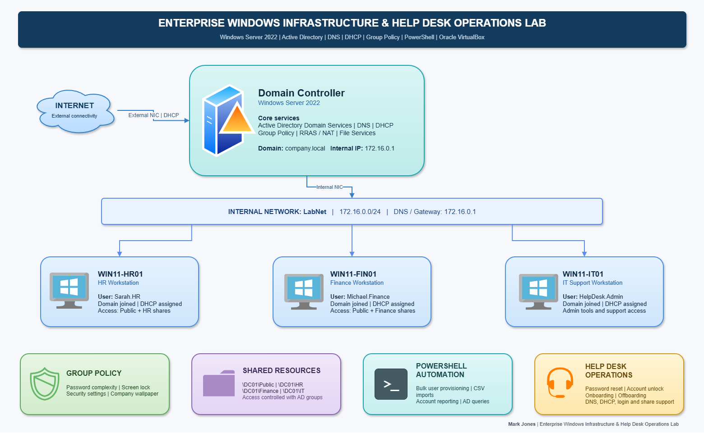
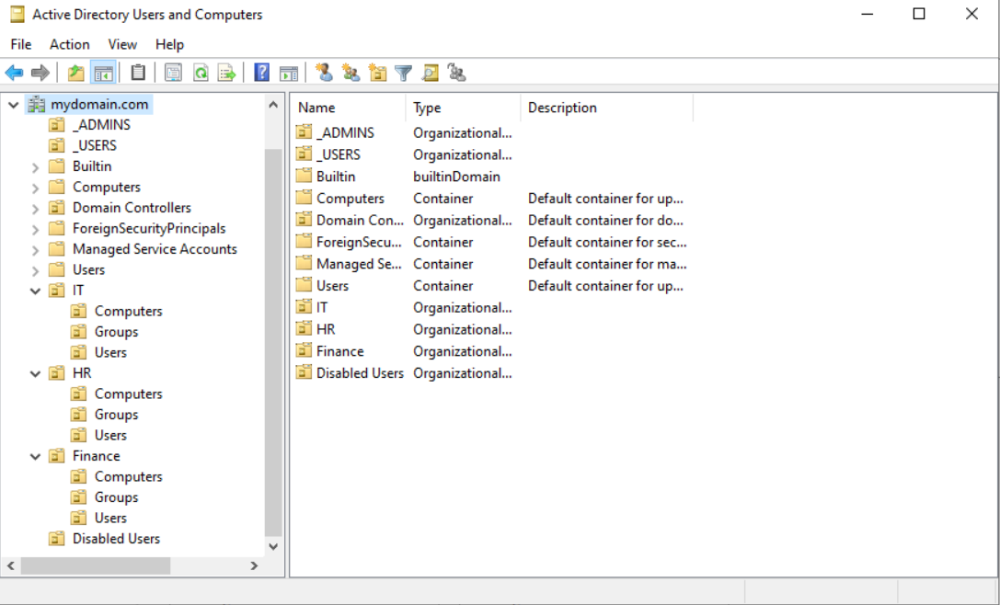
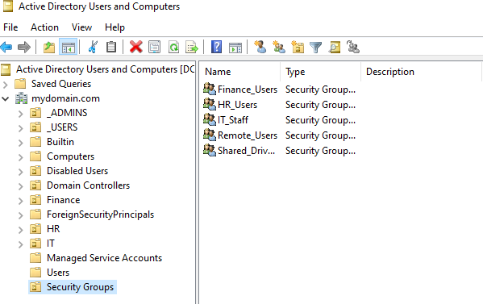
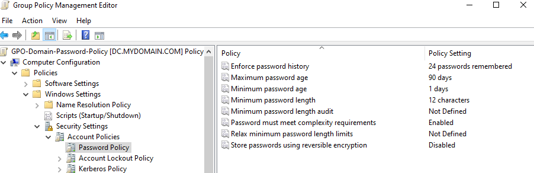
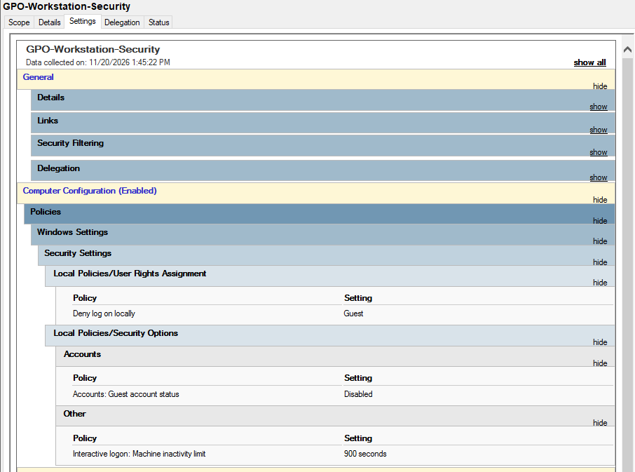
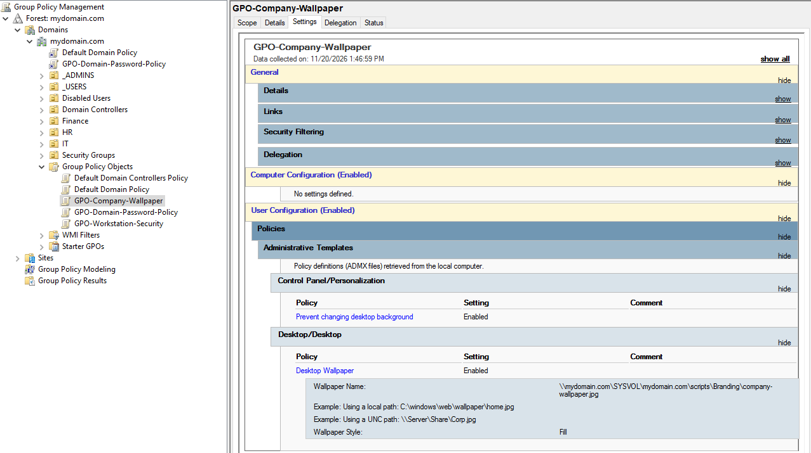
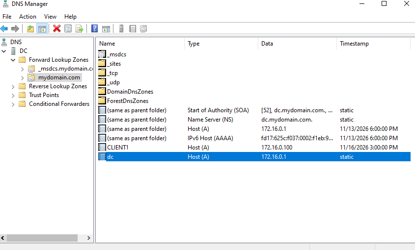
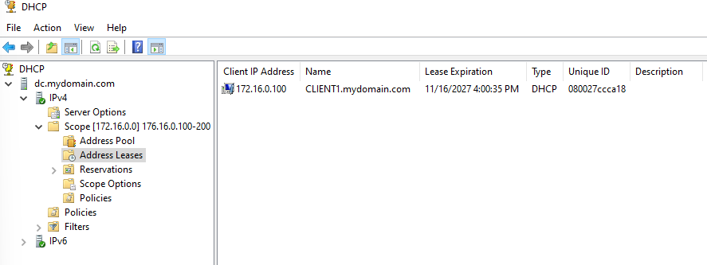
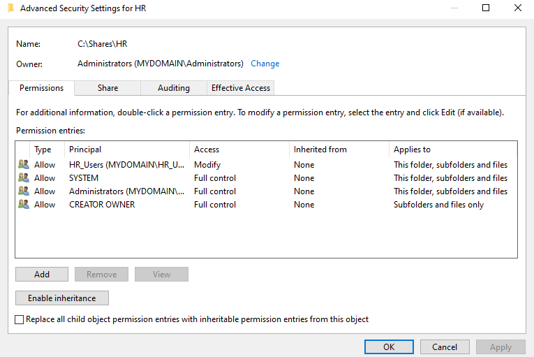

# Enterprise Windows Infrastructure & Help Desk Operations Lab

## Project Overview

This project simulates a small business Windows environment and demonstrates the deployment, administration, and support of enterprise IT infrastructure commonly managed by Help Desk Technicians and System Administrators.

The environment was built in Oracle VirtualBox and includes Active Directory Domain Services (AD DS), DNS, DHCP, Group Policy, shared resources, PowerShell automation, and multiple domain-joined Windows workstations.

The goal of this project was to develop hands-on experience with common IT support responsibilities including account management, workstation deployment, password resets, access control, troubleshooting, and Windows Server administration.

---

## Skills Relevant to Help Desk Roles

- Active Directory Administration
- User Account Management
- Password Resets & Account Unlocks
- Organizational Units (OUs)
- Security Groups
- Group Policy Management (GPO)
- DNS Administration
- DHCP Administration
- Windows 11 Support
- Windows Server 2022 Administration
- File Share Permissions
- PowerShell Automation
- TCP/IP Networking
- Domain Authentication
- Troubleshooting Methodology

---

## Technologies Used

- Windows Server 2022
- Windows 11
- Active Directory Domain Services (AD DS)
- DNS
- DHCP
- Group Policy Management
- PowerShell
- Routing and Remote Access Services (RRAS)
- NAT
- Oracle VirtualBox

---

# Lab Architecture

## Network Diagram



### Environment

| System | Purpose |
|----------|----------|
| Windows Server 2022 | Domain Controller |
| Windows 11 Client 01 | HR Workstation |
| Windows 11 Client 02 | Finance Workstation |
| Windows 11 Client 03 | IT Support Workstation |

### Network Configuration

| Component | Configuration |
|------------|---------------|
| Domain | mydomain.com |
| Internal Network | 172.16.0.0/24 |
| Domain Controller IP | 172.16.0.1 |
| DNS | Active Directory Integrated |
| DHCP | Enabled |
| NAT | Enabled |

---

# Active Directory Infrastructure

## Organizational Unit Structure

```text
mydomain.com
│
├── IT
│   ├── HelpDesk.Admin
│   └── IT.Manager
│
├── HR
│   ├── Sarah.HR
│   └── Emily.HR
│
├── Finance
│   ├── Michael.Finance
│   └── Susan.Finance
│
└── Disabled Users
```

### Screenshot: Organizational Units



---

## User Administration

Created, managed, and maintained user accounts through Active Directory Users and Computers (ADUC).

### Administrative Tasks Performed

- Create Users
- Disable Users
- Unlock Accounts
- Reset Passwords
- Configure Group Memberships
- Manage User Properties

### Screenshot: Active Directory Users and Computers


PowerShell was used to verify that six fictional employee accounts were created in the correct Finance, HR, and IT Organizational Units. The output confirms each account’s domain logon name and role-specific job title.

---

## Security Groups

Implemented Role-Based Access Control (RBAC) using Active Directory Security Groups.

### Security Groups Created

- HR_Users
- Finance_Users
- IT_Staff
- Remote_Users
- Shared_Drive_RW

### Screenshot: Security Groups



---

# Group Policy Administration

Created and deployed Group Policy Objects (GPOs) to manage workstation security and user settings.

## Password Policy

- Enforce password history: 24
- Maximum password age: 90 days
- Minimum password age: 1 day
- Minimum password length: 12 characters
- Password Complexity Enabled
- Reversible encryption: Disabled



## Workstation Security Policy

- Guest Account Disabled
- Screen Lock After 15 Minutes
- Local Security Restrictions Applied



## Company Branding Policy

- Company Desktop Wallpaper Deployed



---

# DNS Administration

Configured and validated Active Directory-integrated DNS.

### Tasks Performed

- Forward Lookup Zone Management
- Domain Name Resolution
- DNS Troubleshooting
- Active Directory Service Discovery Testing

### Screenshot: DNS Manager



### Screenshot: DNS Resolution Testing


**Troubleshooting performed:** During DNS validation, `DC.mydomain.com` returned both the internal `172.16.0.1` address and the VirtualBox NAT address `10.0.2.15`. I disabled DNS registration on the NAT adapter, restricted the DNS Server service to the internal interface, removed the unwanted Host (`A`) record, and verified that authoritative DNS resolution returned only `172.16.0.1`.

---

# DHCP Administration

Configured DHCP scopes and automatic IP address assignment for client systems.

### Tasks Performed

- Created DHCP Scope
- Reserved Address Range
- Configured Lease Settings
- Verified Client Address Assignment

### Screenshot: DHCP Manager



### Screenshot: Client IP Configuration


---

# Shared Resources & Permissions

Created departmental file shares and configured NTFS permissions using Active Directory groups.

## Shared Folders

```text
\\DC\Public
\\DC\HR
\\DC\Finance
\\DC\IT
```

### Access Control

| Folder | Access Group | Share Permission | NTFS Permission |
|---|---|---|---|
| Public | `Domain Users` | Change | Modify |
| HR | `HR_Users` | Change | Modify |
| Finance | `Finance_Users` | Change | Modify |
| IT | `IT_Staff` | Change | Modify |

### Screenshot: Shared Folder Permissions



The HR departmental folder grants `HR_Users` ``Modify`` access to the folder, subfolders, and files. `SYSTEM` and the domain Administrators group retain ``Full Control``, while inheritance is disabled to prevent broad permissions from unrelated users.

---

# PowerShell Automation

Used PowerShell to automate administrative tasks and reduce manual account provisioning.

## Automated Tasks

- Bulk User Creation
- User Import via CSV
- Account Reporting
- Administrative Queries

### Example Commands

```powershell
Import-Csv users.csv | New-ADUser
```

```powershell
Get-ADUser -Filter *
```

### Screenshot: PowerShell User Creation Script


### Screenshot: Created Users


---

# Domain Join Operations

Successfully joined Windows 11 workstations to the Active Directory domain.

### Validation Performed

- Domain Authentication
- DNS Resolution
- Group Policy Application
- Shared Resource Access

### Screenshot: Domain Join


### Screenshot: Domain User Login


---

# Help Desk Ticket Simulations

To simulate real-world IT support tasks, common Help Desk scenarios were completed within the lab environment.

## Ticket #001 – Password Reset

**Issue:** User unable to log in after forgetting password.

### Resolution

- Reset password in Active Directory
- Forced password change at next login
- Verified successful authentication

### Screenshot


---

## Ticket #002 – Account Lockout

**Issue:** User account locked after multiple failed login attempts.

### Resolution

- Reviewed account status
- Unlocked account
- Restored user access

### Screenshot


---

## Ticket #003 – New Employee Onboarding

**Issue:** New employee requires system access.

### Resolution

- Created Active Directory account
- Added user to appropriate OU
- Assigned Security Groups
- Verified access to departmental resources

### Screenshot


---

## Ticket #004 – Employee Offboarding

**Issue:** Employee separation from company.

### Resolution

- Disabled account
- Removed group memberships
- Moved account to Disabled Users OU

### Screenshot


---

## Ticket #005 – Domain Login Failure

**Issue:** User unable to authenticate to domain.

### Root Cause

Incorrect DNS server configuration.

### Resolution

Updated client DNS configuration to use the Domain Controller and successfully joined the domain.

### Screenshot


---

# Troubleshooting Experience

Throughout the project several infrastructure issues were intentionally created and resolved.

### Problems Investigated

- Failed Domain Joins
- DNS Resolution Issues
- DHCP Lease Problems
- Authentication Failures
- Folder Permission Issues
- Network Connectivity Problems

### Tools Used

- Ping
- IPCONFIG
- NSLOOKUP
- Event Viewer
- Active Directory Users & Computers
- Group Policy Management Console

---

# Screenshots

## Infrastructure

- Network Diagram
- Active Directory Users and Computers
- Organizational Units
- Security Groups
- DNS Manager
- DHCP Manager
- Group Policy Management

## Help Desk Operations

- Password Reset
- Account Unlock
- New User Creation
- Disabled User Account
- Shared Folder Permissions

## Client Support

- Domain Join
- Domain User Login
- IP Configuration
- Connectivity Testing

---

# Resume Highlights

- Built and administered a Windows Server 2022 Active Directory environment using Oracle VirtualBox.
- Configured Active Directory, DNS, DHCP, Group Policy, and NAT services to support enterprise authentication and networking.
- Implemented Organizational Units, Security Groups, and Role-Based Access Control (RBAC).
- Automated user administration and account provisioning using PowerShell.
- Simulated real-world Help Desk workflows including password resets, account unlocks, onboarding, offboarding, and troubleshooting.
- Configured departmental file shares and NTFS permissions using Active Directory groups.
- Diagnosed and resolved DNS, DHCP, authentication, and network connectivity issues across multiple domain-joined Windows systems.

---

# Outcome

Successfully designed, deployed, administered, and supported a small-scale enterprise Windows environment that mirrors common responsibilities performed by Help Desk Technicians, Desktop Support Specialists, and Junior System Administrators. The lab demonstrates practical experience with Active Directory, Windows Server administration, user support, identity management, networking, automation, and troubleshooting.
