# Enterprise Windows Infrastructure & Help Desk Operations Lab

## Project Overview

This project simulates a small business Windows environment and demonstrates the deployment, administration, and support of enterprise IT infrastructure commonly managed by Help Desk Technicians and System Administrators.

The environment was built in Oracle VirtualBox and includes Active Directory Domain Services (AD DS), DNS, DHCP, Group Policy, shared resources, PowerShell automation, and multiple domain-joined Windows workstations.

The goal of this project was to develop hands-on experience with common IT support responsibilities including account management, workstation deployment, password resets, access control, troubleshooting, and Windows Server administration.

---

## Skills Relevant to Help Desk Roles

- Active Directory Administration
- User Account Management
- Password Resets & Account Unlocks
- Organizational Units (OUs)
- Security Groups
- Group Policy Management (GPO)
- DNS Administration
- DHCP Administration
- Windows 11 Support
- Windows Server 2022 Administration
- File Share Permissions
- PowerShell Automation
- TCP/IP Networking
- Domain Authentication
- Troubleshooting Methodology

---

## Technologies Used

- Windows Server 2022
- Windows 11
- Active Directory Domain Services (AD DS)
- DNS
- DHCP
- Group Policy Management
- PowerShell
- Routing and Remote Access Services (RRAS)
- NAT
- Oracle VirtualBox

---

# Lab Architecture

## Network Diagram


### Environment

| System | Purpose |
|----------|----------|
| Windows Server 2022 | Domain Controller |
| Windows 11 Client 01 | HR Workstation |
| Windows 11 Client 02 | Finance Workstation |
| Windows 11 Client 03 | IT Support Workstation |

### Network Configuration

| Component | Configuration |
|------------|---------------|
| Domain | mydomain.com |
| Internal Network | 172.16.0.0/24 |
| Domain Controller IP | 172.16.0.1 |
| DNS | Active Directory Integrated |
| DHCP | Enabled |
| NAT | Enabled |

---

# Active Directory Infrastructure

## Organizational Unit Structure

```text
mydomain.com
│
├── IT
│   ├── HelpDesk.Admin
│   └── IT.Manager
│
├── HR
│   ├── Sarah.HR
│   └── Emily.HR
│
├── Finance
│   ├── Michael.Finance
│   └── Susan.Finance
│
└── Disabled Users
```

### Screenshot: Organizational Units


---

## User Administration

Created, managed, and maintained user accounts through Active Directory Users and Computers (ADUC).

### Administrative Tasks Performed

- Create Users
- Disable Users
- Unlock Accounts
- Reset Passwords
- Configure Group Memberships
- Manage User Properties

### Screenshot: Active Directory Users and Computers

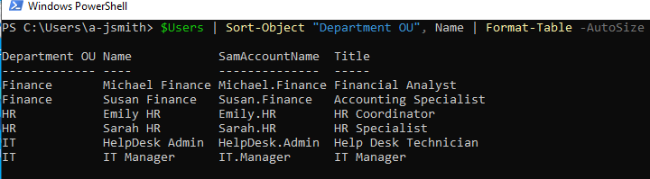

PowerShell was used to verify that six fictional employee accounts were created in the correct Finance, HR, and IT Organizational Units. The output confirms each account’s domain logon name and role-specific job title.

---

## Security Groups

Implemented Role-Based Access Control (RBAC) using Active Directory Security Groups.

### Security Groups Created

- HR_Users
- Finance_Users
- IT_Staff
- Remote_Users
- Shared_Drive_RW

### Screenshot: Security Groups


---

# Group Policy Administration

Created and deployed Group Policy Objects (GPOs) to manage workstation security and user settings.

## Password Policy

- Enforce password history: 24
- Maximum password age: 90 days
- Minimum password age: 1 day
- Minimum password length: 12 characters
- Password Complexity Enabled
- Reversible encryption: Disabled


## Account Lockout Policy

- Locks a domain account after 5 invalid sign-in attempts
- Keeps the account locked for 15 minutes unless an administrator unlocks it
- Resets the failed-attempt counter after 15 minutes

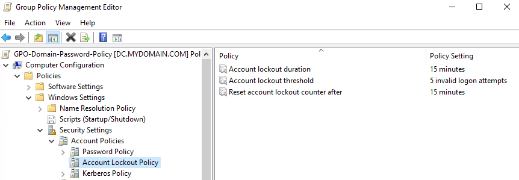

The domain account-lockout policy limits repeated password attempts by locking an account after five invalid sign-ins. The lockout remains active for 15 minutes, and the failed-r 15 minutes. This policy supports Help Desk account-lockout investigation and recovery procedures.

## Workstation Security Policy

- Guest Account Disabled
- Screen Lock After 15 Minutes
- Local Security Restrictions Applied


## Company Branding Policy

- Company Desktop Wallpaper Deployed


---

# DNS Administration

Configured and validated Active Directory-integrated DNS.

### Tasks Performed

- Forward Lookup Zone Management
- Domain Name Resolution
- DNS Troubleshooting
- Active Directory Service Discovery Testing

### Screenshot: DNS Manager


### Screenshot: DNS Resolution Testing

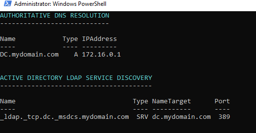

**Troubleshooting performed:** During DNS validation, `DC.mydomain.com` returned both the internal `172.16.0.1` address and the VirtualBox NAT address `10.0.2.15`. I disabled DNS registration on the NAT adapter, restricted the DNS Server service to the internal interface, removed the unwanted Host (`A`) record, and verified that authoritative DNS resolution returned only `172.16.0.1`.

---

# DHCP Administration

Configured DHCP scopes and automatic IP address assignment for client systems.

### Tasks Performed

- Created DHCP Scope
- Reserved Address Range
- Configured Lease Settings
- Verified Client Address Assignment

### Screenshot: DHCP Manager


### Screenshot: Client IP Configuration

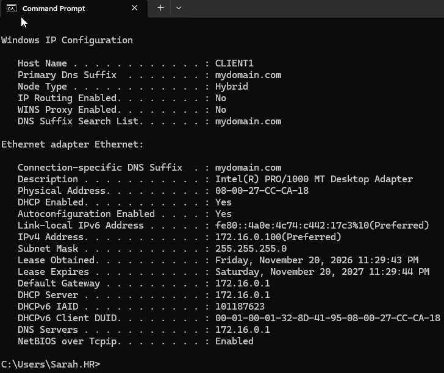

---

# Shared Resources & Permissions

Created departmental file shares and configured NTFS permissions using Active Directory groups.

## Shared Folders

```text
\\DC\Public
\\DC\HR
\\DC\Finance
\\DC\IT
```

### Access Control

| Folder | Access Group | Share Permission | NTFS Permission |
|---|---|---|---|
| Public | `Domain Users` | Change | Modify |
| HR | `HR_Users` | Change | Modify |
| Finance | `Finance_Users` | Change | Modify |
| IT | `IT_Staff` | Change | Modify |

### Screenshot: Shared Folder Permissions


The HR departmental folder grants `HR_Users` **Modify** access to the folder, subfolders, and files. `SYSTEM` and the domain Administrators group retain **Full Control**, while inheritance is disabled to prevent broad permissions from unrelated users.

### Screenshot: SMB Share Access Control

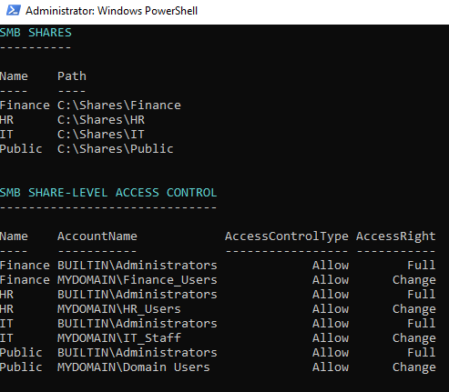

PowerShell verification confirms that all four SMB shares point to the correct local folders. Share-level access is assigned through Active Directory security groups, with departmental users receiving **Change** access and administrators retaining **Full Control**.

---

# PowerShell Automation

Used PowerShell to automate administrative tasks and reduce manual account provisioning.

## Automated Tasks

- Bulk creation of approximately 999 Active Directory user accounts
- Text-file-driven user provisioning using `names.txt`
- Active Directory account reporting
- Administrative queries with `Get-ADUser`

### Example Administrative Query

```powershell
Get-ADUser -Filter * |
Select-Object Name, SamAccountName, Enabled
```

### Screenshot: PowerShell User-Creation Script

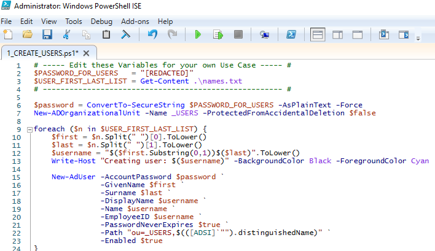

The PowerShell script reads randomized names from `names.txt`, generates standardized account names, creates the `_USERS` Organizational Unit, and provisions enabled Active Directory accounts using `New-ADUser`. The credential value was redacted before publication.

> **Lab security note:** The original automation used non-expiring passwords for disposable lab accounts. In a production environment, password expiration and lifecycle requirements would be enforced through organizational identity and security policies.

### Screenshot: Created Users

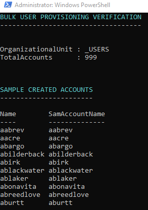

PowerShell verification confirms that **999 Active Directory user accounts** exist in the `_USERS` Organizational Unit and displays a representative sample of the provisioned users and their `SamAccountName` values.

---

# Domain Join Operations

Successfully joined a Windows 11 Pro workstation to the `mydomain.com` Active Directory domain and validated domain authentication, DNS communication, and Domain Controller discovery.

### Validation Performed

- Confirmed Windows 11 Pro domain membership
- Authenticated with a standard domain user account
- Verified the authenticating Domain Controller
- Validated communication with `DC.mydomain.com`
- Confirmed Active Directory Domain Controller discovery
- Verified the workstation's placement in the `HR\Computers` Organizational Unit

### Screenshot: Domain Join Verification

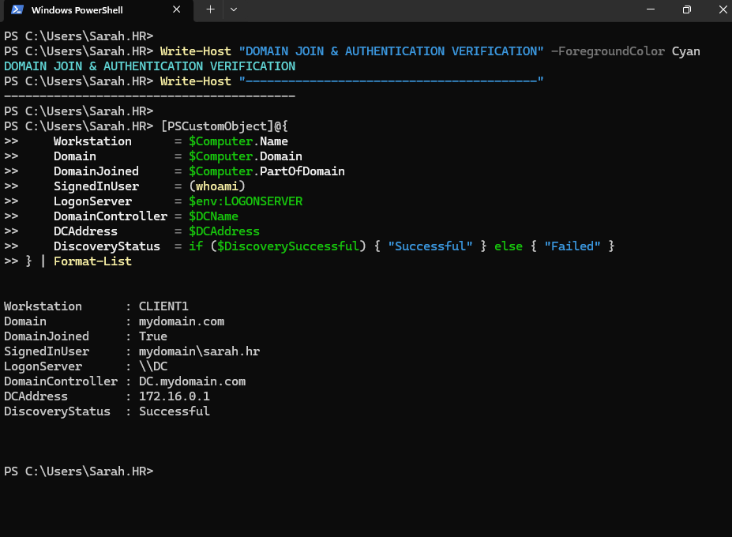

PowerShell verification confirms that `CLIENT1` is joined to the `mydomain.com` Active Directory domain. The active session uses the standard `MYDOMAIN\Sarah.HR` domain account, authentication is handled by `DC`, and live Domain Controller discovery successfully identifies `DC.mydomain.com` at `172.16.0.1`.

### Screenshot: Domain User Login

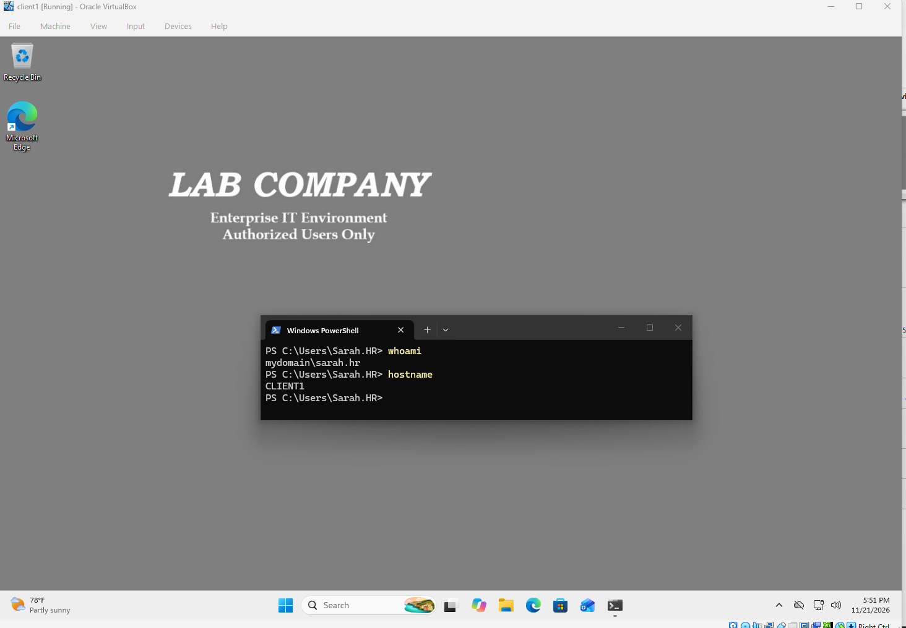

The Windows 11 Pro workstation displays the managed company desktop background while PowerShell confirms that the active session uses the standard `MYDOMAIN\Sarah.HR` domain account on `CLIENT1`.

---

# Help Desk Ticket Simulations

To simulate real-world IT support tasks, common Help Desk scenarios were completed within the lab environment.

## Ticket #001 – Password Reset

**Issue:** `Emily.HR` forgot the domain password and could not sign in to the Windows 11 Pro workstation.

**Actions performed:**

- Located `Emily.HR` in Active Directory Users and Computers
- Assigned a temporary password that met the domain password policy
- Enabled **User must change password at next logon**
- Confirmed that Active Directory accepted the password reset
- Verified that Windows required the user to create a new password
- Confirmed that the new password was successfully applied

**Resolution:** `Emily.HR` created a new private password and regained access to the `mydomain.com` domain.

#### Step 1: Configure the Password Reset

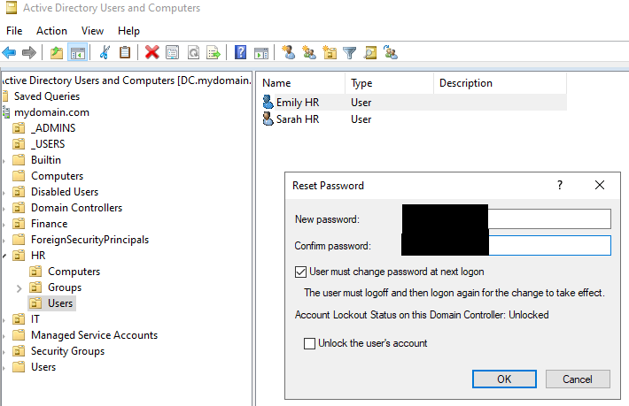

The Help Desk administrator reset the password for `Emily.HR` and enabled **User must change password at next logon**. Credential fields were concealed before publication.

#### Step 2: Confirm the Administrative Reset

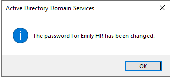

Active Directory Domain Services confirmed that the password for `Emily.HR` was successfully changed.

#### Step 3: Enforce a Password Change at Sign-In

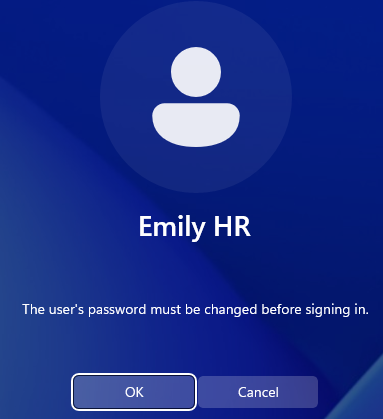

When `Emily.HR` attempted to sign in with the temporary password, Windows required a password change before permitting access to the workstation.

#### Step 4: Create a New Private Password

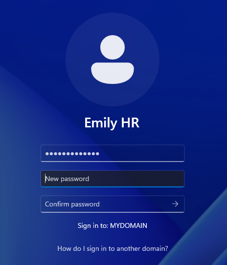

The temporary credential was accepted, and Windows prompted `Emily.HR` to create and confirm a new private password for the domain account.

#### Step 5: Confirm the Password Change

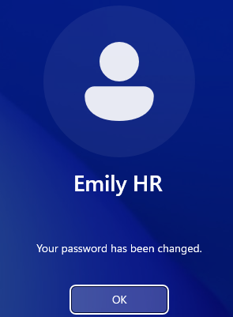

Windows confirmed that the new password was successfully applied to the `Emily.HR` domain account.

#### User Communication

> Hi Emily, your password has been reset. Please sign in using the temporary password provided to you and create a new password when prompted. Contact the Help Desk if you experience any issues.

**Ticket Status:** Pending User Confirmation

---

## Ticket #002 – Account Lockout

**Issue:** `Susan.Finance` was unable to sign in after five invalid password attempts caused the domain account to become locked.

#### Investigation

- Confirmed that the domain account lockout policy was active
- Located `Susan.Finance` in Active Directory Users and Computers
- Verified that Active Directory reported the account as locked
- Confirmed that the user knew the existing password, so a password reset was unnecessary

#### Actions Performed

- Selected **Unlock account** in Active Directory Users and Computers
- Applied the account change without resetting the existing password
- Verified that `Susan.Finance` could authenticate successfully on `CLIENT1`
- Confirmed that the restored session authenticated through the `DC` logon server

**Resolution:** I unlocked the account, and `Susan.Finance` regained access using the existing domain password.

#### Step 1: Review the User-Facing Lockout Message

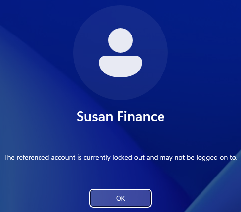

Windows prevented `Susan.Finance` from signing in after the account reached the domaind attempts.

#### Step 2: Confirm the Account Lockout in Active Directory

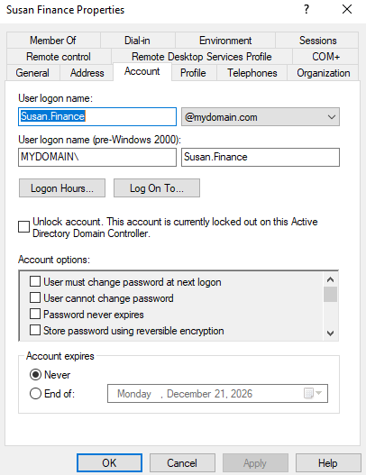

I reviewed the account properties in Active Directory Users and Computers and confirmed that `Susan.Finance` was locked.

#### Step 3: Unlock the User Account

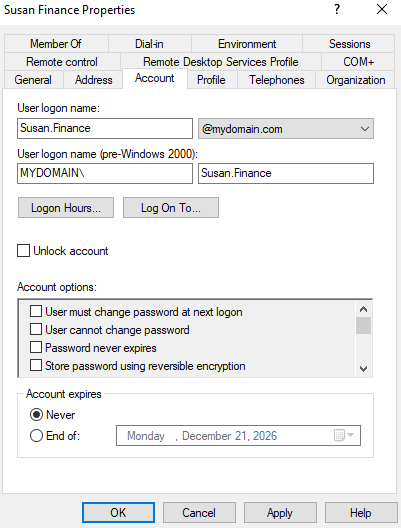

I selected **Unlock account** and applied the change. I retained the existing password because the user confirmed that the correct password was known.

#### Step 4: Validate Restored Domain Access

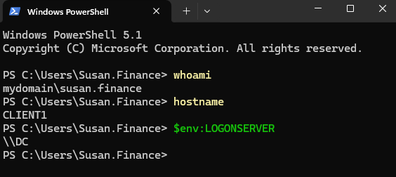

PowerShell confirms that `MYDOMAIN\Susan.Finance` successfully authenticated on `CLIENT1` through the `DC` logon server after I unlocked the account.

#### User Communication

> Hi Susan, your account has been unlocked. Please sign in using your existing password and contact the Help Desk if the issue returns.

**Ticket Status:** Resolved

---

## Ticket #003 – New Employee Onboarding

**Issue:** A new Human Resources employee required a domain account, secure first-time sign-in, and access to the appropriate departmental resources.

**New Employee:** `Olivia.Bennett`  
**Department:** Human Resources  
**Job Title:** HR Assistant  
**Organizational Unit:** `HR\Users`  
**Security Group:** `HR_Users`  
**Authorized Shares:** `\\DC\Public` and `\\DC\HR`  
**Restricted Shares:** `\\DC\Finance` and `\\DC\IT`

#### Investigation and Planning

- I reviewed the employee's department and job responsibilities.
- I identified `HR\Users` as the correct Organizational Unit.
- I identified `HR_Users` as the appropriate departmental security group.
- I confirmed that the employee required access to the Public and HR shared folders.
- I confirmed that Finance and IT resources should remain restricted.

#### Actions Performed

- I created the `Olivia.Bennett` Active Directory account.
- I assigned a temporary password and required a password change at the next sign-in.
- I placed the account in the `HR\Users` Organizational Unit.
- I enabled protection from accidental deletion.
- I configured the employee's title, department, company, and account description.
- I added the account to the `HR_Users` security group.
- I verified successful domain authentication on `CLIENT1`.
- I validated access to the Public and HR shared folders.
- I confirmed that access to the Finance and IT shared folders was denied.

**Resolution:** I completed the employee's Active Directory onboarding, verified the required Human Resources access, and confirmed that unrelated departmental resources remained restricted.

#### Step 1: Create the Active Directory Account

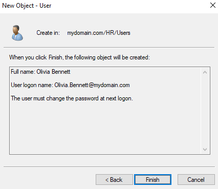

I created the `Olivia.Bennett` domain account in Active Directory Users and Computers. I assigned a temporary password and enabled **User must change password at next logon** so the employee could create a private password during the first sign-in.

#### Step 2: Verify Organizational Unit Placement

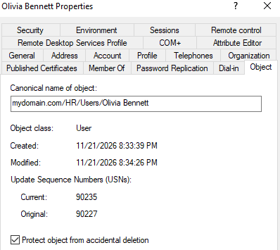

I verified that the `Olivia.Bennett` account was created as a user object inside the `HR\Users` Organizational Unit. I also enabled protection from accidental deletion to reduce the risk of unintentionally removing the account.

#### Step 3: Assign the HR Security Group

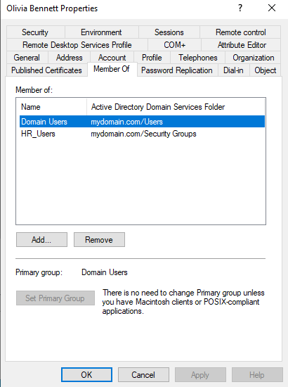

I added `Olivia.Bennett` to the `HR_Users` security group while retaining `Domain Users` as the primary group. This group-based assignment grants the required HR resource access without assigning permissions directly to the individual account.

#### Step 4: Validate Departmental Resource Access

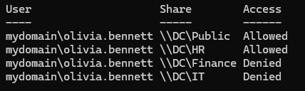

I verified that `MYDOMAIN\Olivia.Bennett` could access `\\DC\Public` and `\\DC\HR`. Access to `\\DC\Finance` and `\\DC\IT` was denied, confirming that the group-based permissions followed the principle of least privilege.

#### User Communication

> Hi Olivia, your domain account setup is complete. Your sign-in and access to the Public and HR shared folders have been verified. Please contact the Help Desk if you experience any additional sign-in or access issues.

**Ticket Status:** Resolved

---

## Ticket #004: Employee Offboarding

**Issue:** Human Resources requested the immediate removal of domain and departmental access for a separated Finance employee.

**Employee Account:** `Michael.Finance`  
**Former Department:** Finance  
**Original Organizational Unit:** `Finance\Users`  
**Final Organizational Unit:** `Disabled Users`  
**Removed Security Group:** `Finance_Users`

#### Investigation and Planning

- I reviewed the account's existing Organizational Unit and security-group memberships.
- I identified `Finance_Users` as the group granting access to the restricted Finance departmental share.
- I confirmed that the account should be disabled and retained for auditing rather than deleted.
- I identified the `Disabled Users` Organizational Unit as the final location for the inactive account.
- I planned to validate that the disabled account could no longer authenticate to the domain.

#### Actions Performed

- I reviewed and documented the account's existing group memberships.
- I disabled the `Michael.Finance` Active Directory account.
- I removed the account from the `Finance_Users` security group.
- I retained `Domain Users` as the account's default primary group.
- I moved the account from `Finance\Users` to the `Disabled Users` Organizational Unit.
- I attempted to sign in with the disabled account on `CLIENT1`.
- I confirmed that Windows blocked the account from authenticating.

**Resolution:** I disabled the separated employee's account, revoked access to Finance resources, moved the account to the designated disabled-account OU, and verified that domain sign-in was blocked.

#### Step 1: Review Existing Group Memberships

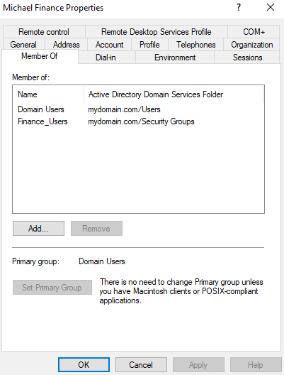

I reviewed the existing group memberships for `Michael.Finance` before making changes. The account belonged to `Finance_Users`, which granted access to the restricted Finance departmental share, while `Domain Users` remained the account's primary group.

#### Step 2: Disable the Active Directory Account

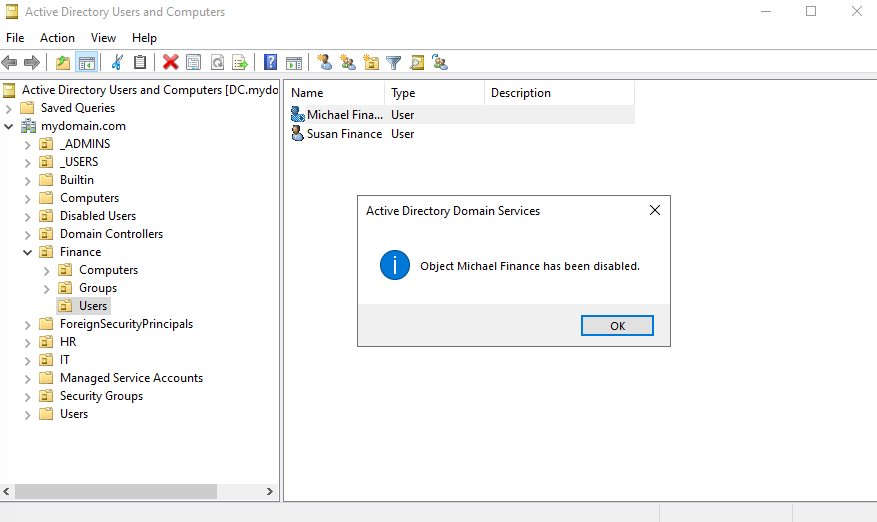

I disabled the `Michael.Finance` account to immediately prevent further domain authentication while retaining the user object for auditing and administrative records.

#### Step 3: Remove Departmental Access

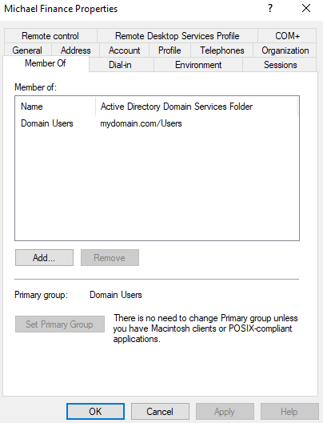

I removed `Michael.Finance` from the `Finance_Users` security group, revoking access to the restricted Finance departmental share. I retained `Domain Users` as the account's default primary group.

#### Step 4: Move the Account to Disabled Users

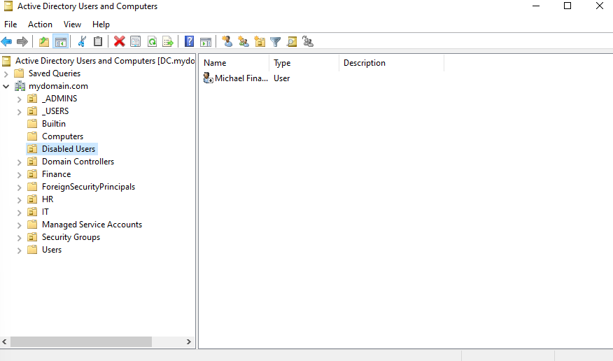

I moved the disabled `Michael.Finance` account from `Finance\Users` to the `Disabled Users` Organizational Unit. The disabled-account icon confirms that the account remained inactive after the move.

#### Step 5: Validate Sign-In Denial


I attempted to sign in to `CLIENT1` using the disabled `MYDOMAIN\Michael.Finance` account. Windows denied the sign-in and confirmed that the account had been disabled, verifying that domain access was successfully revoked.

#### Requester Communication

> Hi HR Team, I disabled the `Michael.Finance` domain account, removed access to Finance resources, and moved the account to the `Disabled Users` Organizational Unit. I also verified that the account can no longer authenticate to the domain.

**Ticket Status:** Resolved

### Ticket #005 – Domain Authentication and Resource Access Failure

**Issue:** `Sarah.HR` reported that `CLIENT1` could not reliably communicate with the domain or access the HR departmental share.

**Affected User:** `Sarah.HR`  
**Affected Workstation:** `CLIENT1`  
**Internal DNS Server:** `172.16.0.1`  
**Incorrect DNS Server:** `8.8.8.8`  
**Domain Controller:** `DC.mydomain.com`  
**Affected Resource:** `\\DC.mydomain.com\HR`

#### Investigation

- I confirmed the identity of the affected user and workstation.
- I reviewed the Ethernet adapter's IPv4 configuration.
- I found that `CLIENT1` was manually configured to use the public DNS server `8.8.8.8`.
- I reviewed the workstation's TCP/IP configuration with `ipconfig /all`.
- I confirmed that the workstation had a valid DHCP address, subnet mask, default gateway, and DHCP server.
- I determined that only the DNS configuration was incorrect.
- I tested the private Active Directory LDAP service record.
- I confirmed that the public DNS server could not locate the private LDAP SRV record.
- I forced Domain Controller discovery and received `ERROR_NO_SUCH_DOMAIN`.
- I confirmed that the HR departmental share was unavailable while the incorrect DNS configuration was active.

**Root Cause:** `CLIENT1` was manually configured to use the public DNS server `8.8.8.8` instead of the internal Active Directory DNS server at `172.16.0.1`. The public resolver could not locate the private LDAP service records required for Active Directory Domain Controller discovery.

#### Actions Performed

- I removed the manually configured public DNS server from the Ethernet adapter.
- I restored automatic, DHCP-provided DNS configuration.
- I renewed the workstation's DHCP configuration.
- I cleared the local DNS resolver cache.
- I verified that the Ethernet adapter received `172.16.0.1` as its DNS server.
- I confirmed that `DC.mydomain.com` resolved to `172.16.0.1`.
- I verified successful Domain Controller discovery.
- I confirmed that `Sarah.HR` regained access to the HR departmental share.

**Resolution:** I restored the DHCP-provided DNS configuration and verified that internal name resolution, Domain Controller discovery, and access to the HR shared folder were functioning normally.

#### Step 1: Confirm the Manual DNS Override

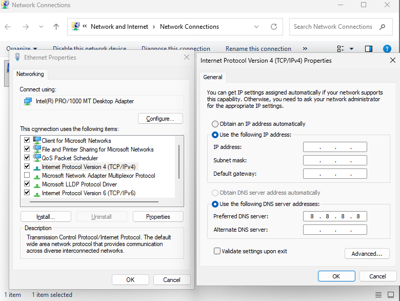

I reviewed the Ethernet adapter's IPv4 properties and confirmed that `CLIENT1` had been manually configured to use the public DNS server `8.8.8.8` instead of obtaining the internal DNS server automatically through DHCP.

#### Step 2: Review the Workstation Network Configuration

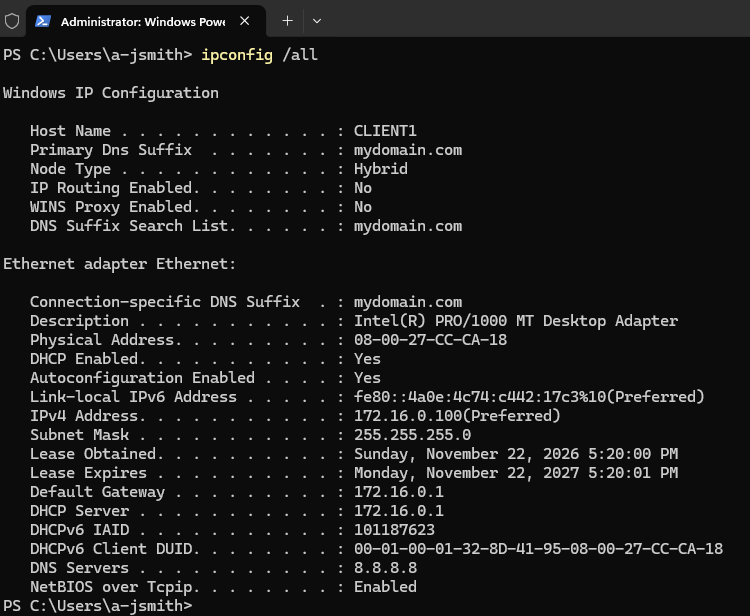

I reviewed `CLIENT1` with `ipconfig /all` from an elevated PowerShell session using the authorized `MYDOMAIN\a-jsmith` support account. The workstation had a valid DHCP address, subnet mask, default gateway, and DHCP server, but the DNS server was incorrectly configured as `8.8.8.8`.

#### Step 3: Reproduce the Domain Discovery Failure

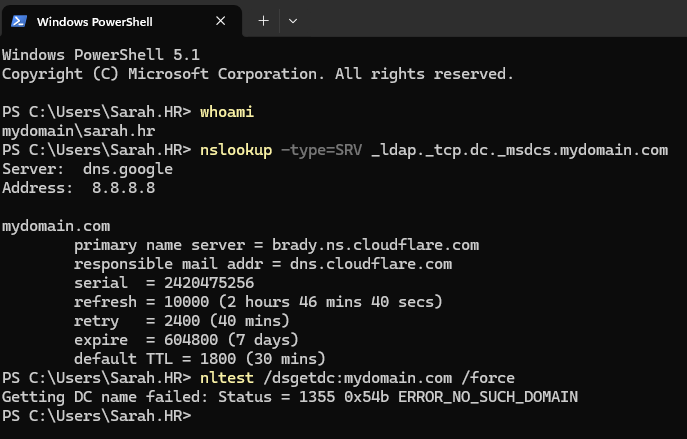

I tested Active Directory service discovery while signed in as `MYDOMAIN\Sarah.HR`. The public DNS server did not return the private LDAP SRV record, and forced Domain Controller discovery failed with `ERROR_NO_SUCH_DOMAIN`. I also confirmed that the HR share was unavailable through `\\DC.mydomain.com\HR`.

#### Step 4: Validate the Resolution

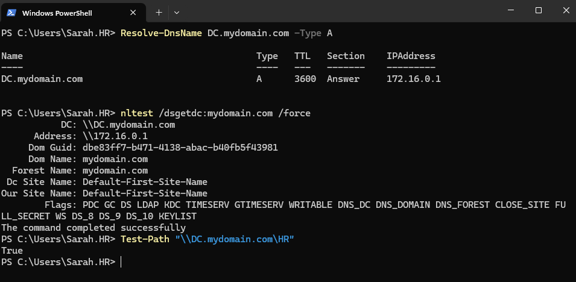

I restored DHCP-provided DNS settings and verified that `DC.mydomain.com` resolved to `172.16.0.1`. I confirmed successful Domain Controller discovery and validated that `MYDOMAIN\Sarah.HR` could access `\\DC.mydomain.com\HR`.

#### User Communication

> Hi Sarah, I corrected the DNS configuration on `CLIENT1` and restored communication with the domain and HR shared resources. Please continue working normally and contact the Help Desk if the issue returns.

**Ticket Status:** Resolved

---

# Troubleshooting Experience

Throughout the project several infrastructure issues were intentionally created and resolved.

### Problems Investigated

- Failed Domain Joins
- DNS Resolution Issues
- DHCP Lease Problems
- Authentication Failures
- Folder Permission Issues
- Network Connectivity Problems

### Tools Used

- Ping
- IPCONFIG
- NSLOOKUP
- Event Viewer
- Active Directory Users & Computers
- Group Policy Management Console

---

# Screenshots

## Infrastructure

- Network Diagram
- Active Directory Users and Computers
- Organizational Units
- Security Groups
- DNS Manager
- DHCP Manager
- Group Policy Management

## Help Desk Operations

- Password Reset
- Account Unlock
- New User Creation
- Disabled User Account
- Shared Folder Permissions

## Client Support

- Domain Join
- Domain User Login
- IP Configuration
- Connectivity Testing

---

# Resume Highlights

- Built and administered a Windows Server 2022 Active Directory environment using Oracle VirtualBox.
- Configured Active Directory, DNS, DHCP, Group Policy, and NAT services to support enterprise authentication and networking.
- Implemented Organizational Units, Security Groups, and Role-Based Access Control (RBAC).
- Automated user administration and account provisioning using PowerShell.
- Simulated real-world Help Desk workflows including password resets, account unlocks, onboarding, offboarding, and troubleshooting.
- Configured departmental file shares and NTFS permissions using Active Directory groups.
- Diagnosed and resolved DNS, DHCP, authentication, and network connectivity issues across multiple domain-joined Windows systems.

---

# Outcome

Successfully designed, deployed, administered, and supported a small-scale enterprise Windows environment that mirrors common responsibilities performed by Help Desk Technicians, Desktop Support Specialists, and Junior System Administrators. The lab demonstrates practical experience with Active Directory, Windows Server administration, user support, identity management, networking, automation, and troubleshooting.
